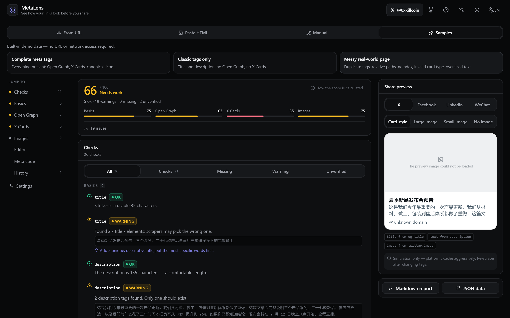
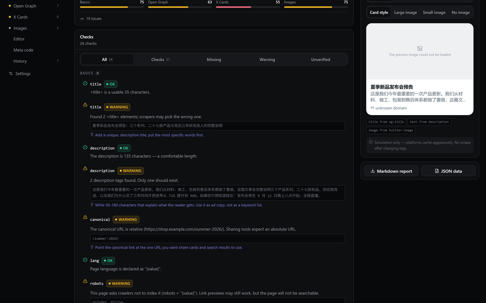
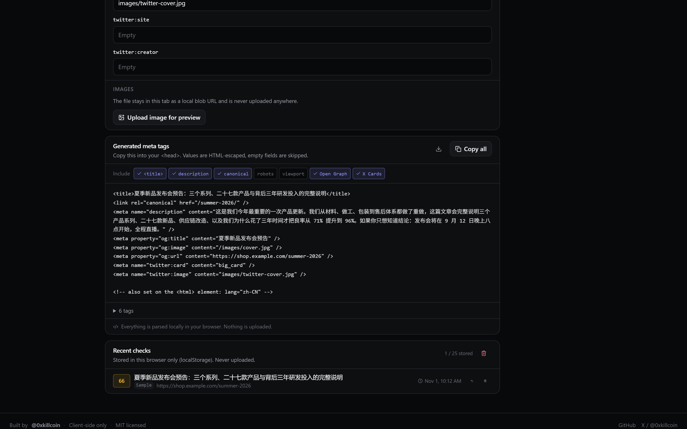
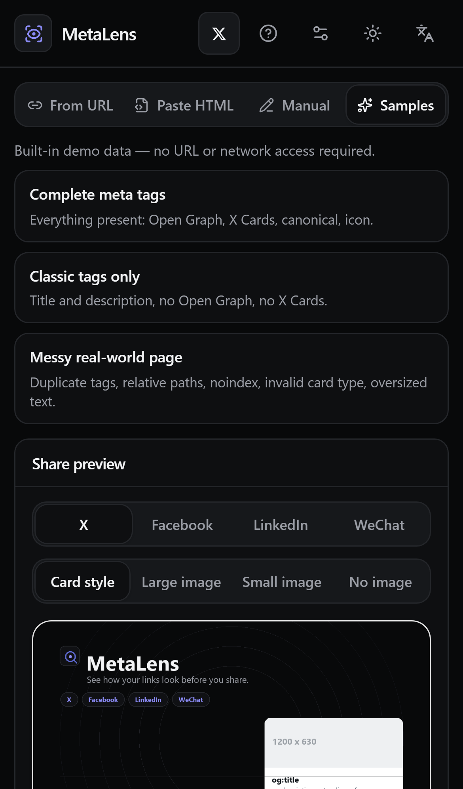
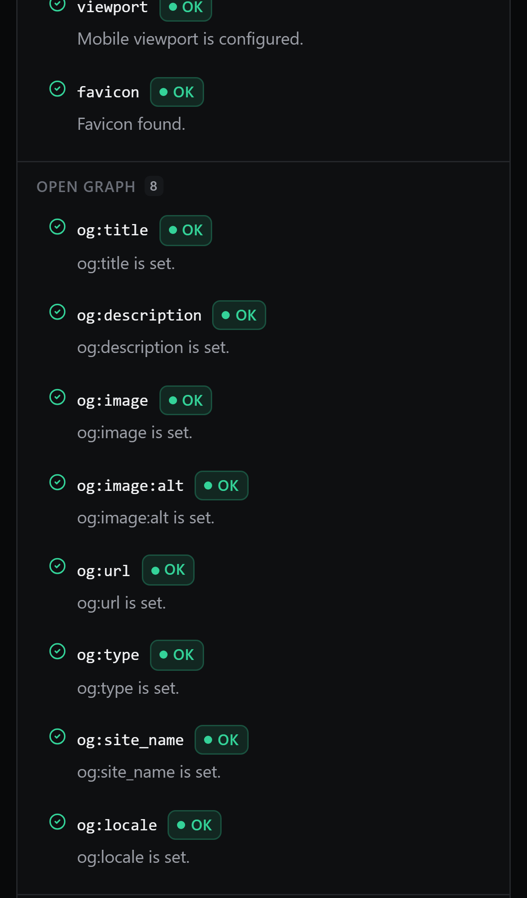

<div align="center">

# MetaLens

**See how your links look before you share.**

Inspect a page's title, description, Open Graph and X Card tags, preview the card
X / Facebook / LinkedIn / WeChat would build, fix the values inline, and copy
production-ready markup.

[](https://github.com/iiiiiiiiiiiiiKK/metalens/actions/workflows/ci.yml)
[](LICENSE)
[](https://iiiiiiiiiiiiiKK.github.io/metalens/)
[](https://metalens.pages.dev/)

[Live demo](https://iiiiiiiiiiiiiKK.github.io/metalens/) ·
[Mirror](https://metalens.pages.dev/) ·
[Author on X](https://x.com/0xkillcoin) ·
[中文说明](README.zh-CN.md)

</div>



---

## Why

A link shared on X, Facebook or LinkedIn is usually the first thing a reader sees
of your page. If `og:image` is missing, or `og:title` still says "Home | Untitled
Document", nobody notices until the post is live — and platforms cache aggressively,
so fixing it later is painful.

MetaLens closes that loop:

- **Inspect** — every meta tag that matters, with the real values, not a score alone.
- **Preview** — four platform cards rendered from those exact tags.
- **Fix** — edit any field and watch every preview update live.
- **Ship** — copy escaped, ordered `<meta>` markup, or export the whole report.

Everything runs in your browser. There is no account, no tracking, and no upload
of the page you inspect.

## Features

| Area | What it does |
| --- | --- |
| **Two input modes** | Paste the page HTML (always works, parsed locally) or supply a URL (fetched via CORS, or through the optional hardened fetch endpoint). |
| **Full tag extraction** | `<title>`, description, canonical, `lang`, `robots`, `viewport`, favicon, all Open Graph fields, all X Card fields, plus every unmodelled meta tag listed for transparency. |
| **Diagnostics, not just a score** | Missing, empty, duplicated and malformed fields; relative/invalid URLs; canonical mismatches; length advisories; unknown card types. Each finding carries the actual value and a concrete fix. |
| **Four platform previews** | X (large / small / no image), Facebook, LinkedIn and a WeChat-style card, each applying that platform's documented fallback chain. |
| **Live editor** | Edit title, description, canonical, language and every OG / X field; previews and generated code update on every keystroke. Reset returns to the inspected values. |
| **Image checks** | Probes `og:image` / `twitter:image` for real pixel dimensions. If the image cannot load, MetaLens says "unverified" — it never invents a size. Manual upload previews a local file without uploading it. |
| **Code generator** | Ordered, HTML-escaped `<meta>` output with per-tag copy, toggleable groups, and `.html` download. |
| **Reports** | One-click Markdown or JSON export of the findings, the health breakdown and the generated markup. |
| **History** | The last 25 checks, stored in `localStorage` only, with per-entry delete and a confirmed clear-all. |
| **Bilingual + theme** | English / 中文 and dark / light, both persisted. Switching language never touches the inspected data. |
| **Mobile-first** | Single-column layout on phones, horizontally switchable platform tabs, 44px touch targets, 16px inputs (no iOS zoom), safe-area padding, and a hard guarantee of no page-level horizontal scroll. |

## Screenshots

| Findings | Generated markup |
| --- | --- |
|  |  |

| iPhone — preview | iPhone — findings |
| --- | --- |
|  |  |

All screenshots are captured from the deployed build by
`scripts/capture-screenshots.mjs` (Chromium at 1440×900 @2x, WebKit with an
iPhone 13 descriptor). No mockups.

## Try it in ten seconds

1. Open the [live demo](https://iiiiiiiiiiiiiKK.github.io/metalens/).
2. Click **Samples → Complete meta tags**. Three built-in demo documents are
   available, all clearly labelled as demo data:
   - *Complete meta tags* — the happy path, nothing to fix.
   - *Classic tags only* — a page with no Open Graph and no X Cards.
   - *Messy real-world page* — duplicate titles, relative image paths, `noindex`,
     an invalid card type and over-long copy.
3. Switch the preview between X, Facebook, LinkedIn and WeChat.
4. Edit `og:title` in the editor and watch the cards and the markup change.

## How it works

```
                        ┌──────────────────────────────────────────┐
  paste HTML  ─────────►│ Library (src/lib)                        │
  (Mode A, local)       │  parse.ts   → inert DOMParser            │
                        │  analysis.ts → Finding[]                 │
  URL ──► CORS fetch ──►│  health.ts  → weighted score (published) │
      └─► fetch endpoint│  preview.ts → per-platform card model    │
          (Mode B)      │  codegen.ts → escaped markup             │
                        │  report.ts  → Markdown / JSON            │
                        └───────────────┬──────────────────────────┘
                                        │
                     React UI (src/components) → previews, findings,
                     editor, code, history, i18n, theme
```

- **Parsing is inert.** User HTML goes through `DOMParser` into a detached
  document. Scripts never run, sub-resources are never fetched, and nothing is
  inserted into the live DOM.
- **The analysis layer is pure.** `analyze(doc, report, probes)` is a
  deterministic function of its inputs, which is why the unit tests can cover it
  exhaustively without a browser.
- **Previews are derived, not hard-coded.** Each platform has an explicit
  fallback chain (`twitter:title → og:title → <title>`, and so on) and the UI
  shows *which* tag supplied each visible value.
- **No state library.** A single `useInspector` hook owns the document, probes,
  history and preferences.

### What gets checked

| Group | Fields |
| --- | --- |
| Basics | `title`, `description`, `canonical`, `lang`, `robots`, `viewport`, favicon |
| Open Graph | `og:title`, `og:description`, `og:image`, `og:image:alt`, `og:url`, `og:type`, `og:site_name`, `og:locale` |
| X Cards | `twitter:card`, `twitter:title`, `twitter:description`, `twitter:image`, `twitter:site`, `twitter:creator` |
| Images | absolute-URL check, real dimensions, aspect ratio, and an explicit "unverified" state when the image cannot be loaded |

Per field MetaLens reports the actual value, one of four statuses
(**OK / Missing / Warning / Unverified**), the specific problem, and a concrete
suggestion.

### The health score

The number is a convenience summary; the findings list is the authoritative
output. The rules are published in the app (**? → How the score is calculated**)
and here:

```
score = round(100 × Σ(weight × statusCredit) / Σ(weight))
```

- **Status credit** — OK `1.0`, Unverified `0.75`, Warning `0.55`, Missing `0`.
- **Weights** — `title`, `description`, `og:title`, `og:description`, `og:image`,
  `twitter:card`, `twitter:image` = **3**; `canonical`, `viewport`, `favicon`,
  `og:url`, `og:type`, `twitter:title`, `twitter:description` = **2**;
  `lang`, `robots`, `og:site_name`, `og:locale`, `og:image:alt`, `twitter:site`,
  `twitter:creator` = **1**. Informational findings weigh `0` and are excluded.
- An empty finding list scores `0`, never `100`.

## Running locally

```bash
git clone https://github.com/iiiiiiiiiiiiiKK/metalens.git
cd metalens
npm install
npm run dev        # http://127.0.0.1:5173
```

Requirements: Node.js ≥ 20.19. No environment variables are required.

| Script | Purpose |
| --- | --- |
| `npm run dev` | Vite dev server |
| `npm run build` | Typecheck + production build into `dist/` |
| `npm run preview` | Serve the production build |
| `npm run typecheck` | `tsc --noEmit` |
| `npm run lint` | ESLint (flat config, typescript-eslint + react-hooks) |
| `npm run format` | Prettier check (`format:write` to fix) |
| `npm test` | Vitest unit suite |
| `npm run test:e2e` | Playwright: desktop Chromium + iPhone 13 (WebKit) + iPhone SE 320px |
| `npm run worker:build` | Bundle the fetch endpoint |

### Environment variables

See [`.env.example`](.env.example). The app needs none; they only affect builds
and deployments.

| Name | Used by | Meaning |
| --- | --- | --- |
| `VITE_BASE_PATH` | build | `/` for a root domain, `/metalens/` for a GitHub Pages project page. |
| `VITE_FETCH_ENDPOINT` | optional | Default fetch endpoint baked into `public/runtime-config.json`. Can also be set at runtime in **Settings**. |
| `CLOUDFLARE_API_TOKEN`, `CLOUDFLARE_ACCOUNT_ID` | deployment scripts | Cloudflare upload credentials. Never committed. |
| `PAGES_PROJECT` | `npm run deploy:pages` | Cloudflare Pages project name (default `metalens`). |

## Testing

```bash
npm test        # unit
npm run test:e2e   # end-to-end
```

**Unit — Vitest + jsdom.** 208 tests across 11 files, covering HTML parsing, tag
extraction, OG/X extraction, duplicate and empty detection, URL normalization,
relative image resolution, escaping, markup generation, health scoring, history
persistence, preview fallback chains, i18n dictionary parity, the demo samples,
and the SSRF rules of the fetch endpoint.

The i18n test reads `src/lib/analysis.ts` at runtime and fails if any finding
code lacks an English or Chinese translation, so a new check cannot ship
untranslated.

**End-to-end — Playwright.** 31 scenarios, each run on three profiles
(`chromium-desktop` 1440×900, `iphone-13` WebKit, `iphone-se` 320px) = 93 runs:
paste HTML → inspect, duplicate/invalid detection, honest CORS failure with
fallback actions, editor → live preview updates, platform switching, variant
switching, reset, copy-to-clipboard, Markdown/JSON export, history
save/delete/clear/persistence, language switching without data loss, theme
persistence, endpoint settings validation, and mobile checks (no horizontal
overflow at 320px, ≥44px touch targets, ≥16px inputs, contained nav scrolling).

## Deployment

### GitHub Pages (primary)

Live: **https://iiiiiiiiiiiiiKK.github.io/metalens/**

`.github/workflows/deploy.yml` builds with `VITE_BASE_PATH=/metalens/` and
publishes `dist/` to the `gh-pages` branch on every push to `main`. Enable it
once under **Settings → Pages → Build and deployment → Deploy from a branch →
`gh-pages` / root**.

### Cloudflare Pages (mirror + fetch API)

Live: **https://metalens.pages.dev/** — fetch API: **`/api/fetch`**

```bash
export CLOUDFLARE_API_TOKEN=...
export CLOUDFLARE_ACCOUNT_ID=...
npm run deploy:pages
```

The script builds the site at the domain root, bundles `worker/src/pages.ts` into
`dist/_worker.js` (advanced mode) together with a `_routes.json` that scopes the
function to `/api/*`, and uploads through the Pages direct-upload API — no
wrangler install required. Static assets are served from the CDN; only `/api/*`
invokes the function.

### Self-hosted fetch endpoint (optional)

`worker/` contains the same handler as a standalone Cloudflare Worker:

```bash
export CLOUDFLARE_API_TOKEN=... CLOUDFLARE_ACCOUNT_ID=...
npm run deploy:worker          # uploads + smoke-tests the SSRF guards
# or, with wrangler:
npx wrangler deploy --config worker/wrangler.toml
```

Then point the UI at it (either `runtime-config.json` → `fetchEndpoint`, or
**Settings → Fetch endpoint**). Limits on the Workers free plan apply — see the
[Cloudflare pricing page](https://developers.cloudflare.com/workers/platform/pricing/);
MetaLens never upgrades a plan on your behalf.

## URL mode: CORS and SSRF

Browsers cannot read a cross-origin page unless that page allows it. MetaLens
does not pretend otherwise:

1. It first tries a direct `fetch` (works only when the target sends permissive
   CORS headers).
2. If that fails and an endpoint is configured, it asks the endpoint.
3. Otherwise it shows exactly why it failed and offers three real alternatives:
   paste the HTML, fill the fields manually, or deploy your own endpoint. A failed
   fetch never produces a fabricated report.

The fetch endpoint is a public proxy for arbitrary URLs, so it is hardened:

| Control | Implementation |
| --- | --- |
| Scheme | `http:` / `https:` only |
| Credentials | URLs with `user:pass@` refused |
| Ports | 80, 443, 8080, 8443 only |
| Hostnames | `localhost`, `.local`, `.internal`, `.intranet`, `.lan`, `.home.arpa`, metadata names refused |
| IP literals | private, loopback, link-local, CGNAT, multicast, reserved, IPv6 ULA/link-local/`::ffff:` mapped — all refused |
| DNS rebinding | resolved over DNS-over-HTTPS and **every** A/AAAA answer must be public; re-resolved on every hop |
| Redirects | followed manually, max 3, each hop re-validated |
| Response | must be HTML/XML, capped at 1 MiB, 8s deadline |
| Content | returned as text; never executed, never rendered server-side |
| Rate limit | 20 requests / 60s per client IP |
| CORS | explicit origin allowlist — never `*` |

Unit tests (`tests/unit/worker.test.ts`) assert each of these, including that
`169.254.169.254`, `10.0.0.1`, `[::1]`, `metadata.google.internal` and
`file:///etc/passwd` are all refused before any network access.

Known limitation: the rate limiter is an isolate-local map, so the effective
limit is per Cloudflare isolate/POP rather than strictly global. For hostile
traffic, put Cloudflare's Rate Limiting rules or Turnstile in front of it.

## Security and privacy

- Your HTML is parsed in an inert document: scripts never execute, resources are
  never loaded from the pasted markup.
- No analytics, no ads, no third-party requests except the preview images you
  explicitly inspect and, if you use URL mode, the endpoint you chose.
- The only host contacted automatically is the one serving `og:image`, because a
  preview without the real image would be a lie.
- History lives in `localStorage` (max 25 entries) and has delete/clear controls.
- The production build ships a CSP (`default-src 'self'`, `img-src https: data: blob:`,
  no `unsafe-eval`, `frame-ancestors 'none'`), plus `nosniff` and a strict
  referrer policy via `public/_headers`.
- The app never asks for a secret and stores none. The fetch endpoint holds no
  credentials either.

## Known limitations

- **Simulation, not emulation.** Cards are built from meta tags, applying each
  platform's documented precedence. Platforms cache, A/B-test and truncate
  differently; MetaLens cannot reproduce that. Every preview says so.
- **Length advisories are guidance.** They are not platform rules and are marked
  as advisory in the UI.
- **Image dimensions require a loadable image.** Hotlink protection or CORS can
  block the probe; the result is then "unverified", never a guess.
- **URL mode depends on CORS or an endpoint.** GitHub Pages cannot run server
  code, so the static deployment relies on the Cloudflare endpoint for sites that
  do not send CORS headers.
- **Vision-based verification is limited.** Layout was verified by automated DOM
  measurements (overflow, tap sizes, font sizes) and by real screenshots, not by
  human visual review.
- **The score is heuristic.** Its weights are published and deliberately simple.

## Roadmap

- Compare the live page against a previously saved snapshot.
- JSON-LD / schema.org inspection.
- Share a report as a URL fragment (no server).
- Slack and Discord card simulations.

## Contributing

Issues and PRs are welcome. Please run `npm run typecheck && npm run lint &&
npm test && npm run test:e2e` before opening a pull request. New checks must add
a translation for both languages — the i18n test will fail otherwise.

## License

[MIT](LICENSE) © 2026 [@0xkillcoin](https://x.com/0xkillcoin)

Dependencies are MIT/ISC/Apache-2.0 licensed; run `npx license-checker --summary`
to verify your own tree.
