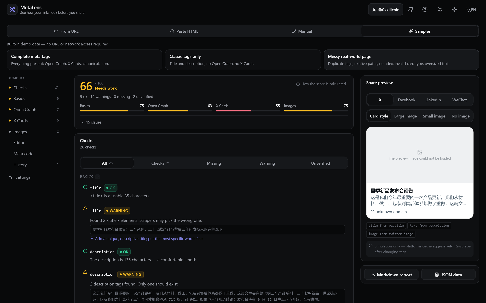
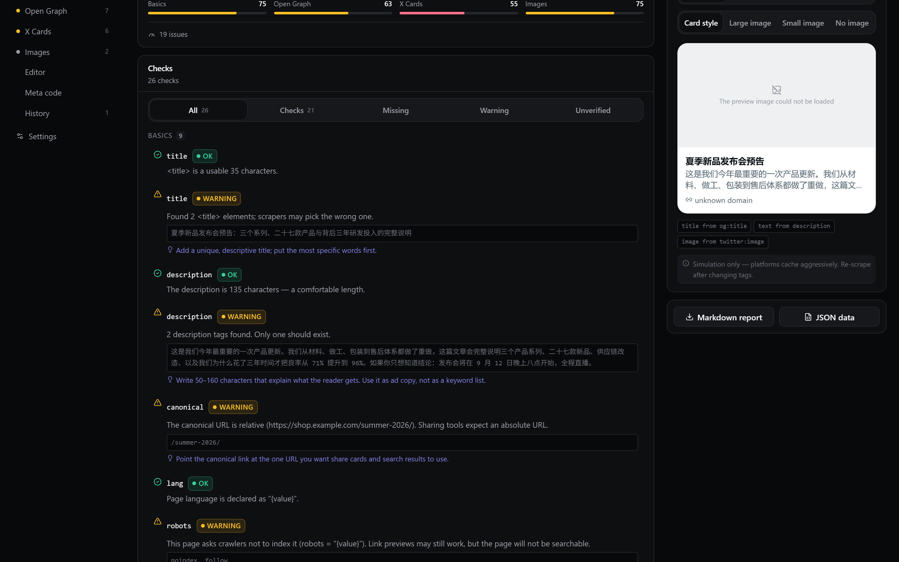
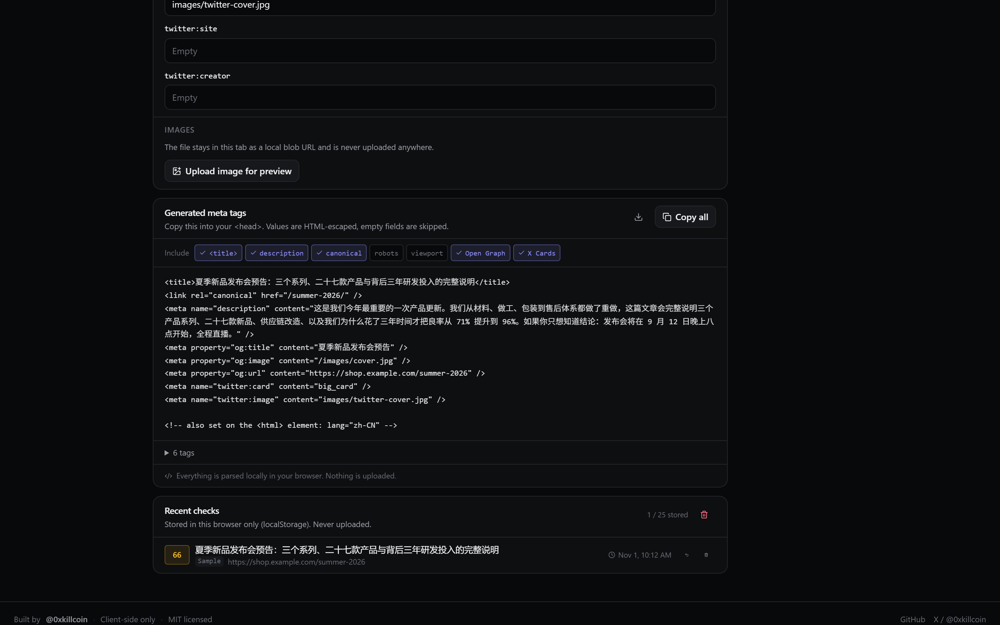
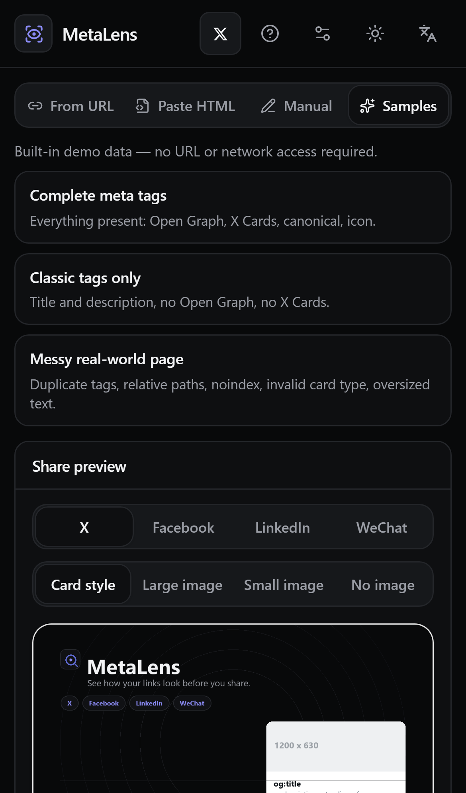
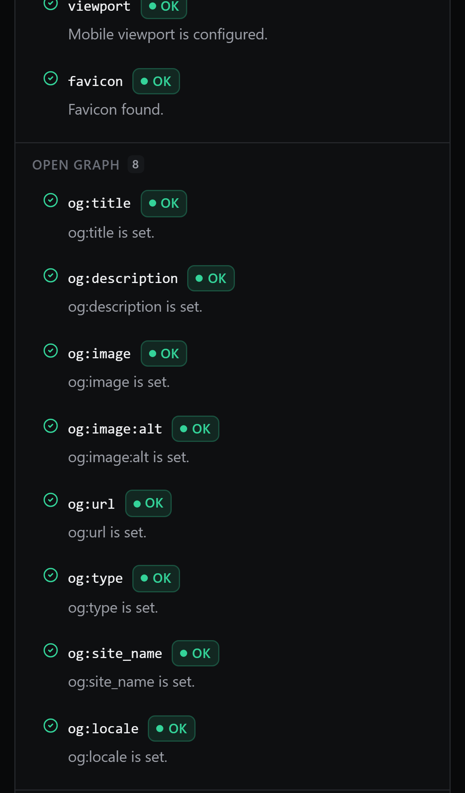

<div align="center">

# MetaLens

**分享之前，先看看链接呈现的样子。**

检查页面的标题、描述、Open Graph 与 X Card 标签，预览 X / Facebook / LinkedIn / 微信
会生成的分享卡片，直接改字段，再复制一份可上线的标准代码。

[](https://github.com/iiiiiiiiiiiiiKK/metalens/actions/workflows/ci.yml)
[](LICENSE)
[](https://iiiiiiiiiiiiiKK.github.io/metalens/)
[](https://metalens.pages.dev/)

[在线体验](https://iiiiiiiiiiiiiKK.github.io/metalens/) ·
[镜像站点](https://metalens.pages.dev/) ·
[作者 X](https://x.com/0xkillcoin) ·
[English](README.md)

</div>



---

## 为什么做这个

一条链接在 X、Facebook、LinkedIn 上，往往是读者看到你页面的第一眼。如果 `og:image`
缺失，或者 `og:title` 还是「首页 | 未命名文档」，通常要等发布之后才会有人发现——而平台缓存
非常顽固，事后修改代价很大。

MetaLens 把这条闭环补上：

- **检查** —— 每个重要的 Meta 标签都给出真实取值，而不是只丢一个分数。
- **预览** —— 用这组标签渲染四个平台的卡片。
- **修改** —— 编辑任意字段，所有预览即时更新。
- **上线** —— 复制转义好、顺序正确的 `<meta>` 代码，或导出完整报告。

全部在浏览器本地完成。没有账号、没有埋点，你检查的页面也不会上传。

## 功能

| 模块 | 说明 |
| --- | --- |
| **两种输入模式** | 粘贴 HTML（始终可用，本地解析）或输入 URL（走 CORS 直连，或使用可选的自建抓取服务）。 |
| **完整字段提取** | `<title>`、描述、canonical、`lang`、`robots`、`viewport`、favicon、全部 Open Graph 字段、全部 X Card 字段，以及所有未建模的标签（原样列出，保持透明）。 |
| **诊断而非只有一个分数** | 缺失、为空、重复、格式错误；相对/非法 URL；canonical 不一致；长度建议；未知卡片类型。每条都带实际取值和具体修复建议。 |
| **四平台预览** | X（大图 / 小图 / 无图）、Facebook、LinkedIn、微信风格卡片，各自套用该平台公开的回退顺序。 |
| **实时编辑器** | 可改标题、描述、canonical、语言以及全部 OG / X 字段；预览与生成代码随输入更新，一键恢复原始值。 |
| **图片检查** | 真实加载 `og:image` / `twitter:image` 并读取像素尺寸。图片加载不了就标为「无法验证」，绝不编造尺寸。支持上传本地图片预览（不会上传）。 |
| **代码生成** | 顺序固定、HTML 转义的 `<meta>` 输出，支持单条复制、分组开关、下载 `.html`。 |
| **报告导出** | 一键导出 Markdown 或 JSON：问题清单、健康度明细、生成代码。 |
| **历史记录** | 最近 25 次检查，仅存在 `localStorage`，可单条删除、可确认后清空。 |
| **中英双语 + 主题** | 中文 / English 与深色 / 浅色，均会记忆。切换语言不影响已检查的数据。 |
| **移动端优先** | 手机端单列布局、平台预览可横向切换、44px 触控目标、16px 输入框（避免 iOS 自动放大）、安全区适配，并保证页面级绝不横向溢出。 |

## 截图

| 检查结果 | 生成的 Meta 代码 |
| --- | --- |
|  |  |

| iPhone — 预览 | iPhone — 检查结果 |
| --- | --- |
|  |  |

所有截图都由 `scripts/capture-screenshots.mjs` 从真实构建中抓取
（Chromium 1440×900 @2x，以及 WebKit 的 iPhone 13 描述符），不是效果图。

## 十秒上手

1. 打开[在线站点](https://iiiiiiiiiiiiiKK.github.io/metalens/)。
2. 点击 **示例 → 标签完整的页面**。内置三份演示文档，均明确标注为演示数据：
   - *标签完整的页面* —— 没有问题的正例。
   - *只有经典标签* —— 没有 Open Graph、没有 X Cards。
   - *真实的混乱页面* —— 重复标题、相对图片路径、`noindex`、非法卡片类型、过长文案。
3. 在 X / Facebook / LinkedIn / 微信之间切换预览。
4. 在编辑器里改一下 `og:title`，观察卡片和代码同步变化。

## 工作原理

```
                        ┌──────────────────────────────────────────┐
  粘贴 HTML  ──────────►│ 纯函数层 (src/lib)                       │
  （模式 A，本地）      │  parse.ts    → 惰性 DOMParser            │
                        │  analysis.ts → Finding[]                 │
  URL ──► CORS 直连 ───►│  health.ts   → 公开规则的加权评分        │
      └─► 抓取服务      │  preview.ts  → 各平台卡片模型            │
          （模式 B）    │  codegen.ts  → 转义后的标签代码          │
                        │  report.ts   → Markdown / JSON           │
                        └───────────────┬──────────────────────────┘
                                        │
                       React 界面 (src/components) → 预览、问题、
                       编辑器、代码、历史、i18n、主题
```

- **解析是惰性的。** 用户 HTML 只会进入一个游离的 `DOMParser` 文档：脚本不执行、子资源不加载、
  也不会插入真实 DOM。
- **分析层是纯函数。** `analyze(doc, report, probes)` 只依赖入参，因此单元测试可以穷举覆盖，无需浏览器。
- **预览是推导出来的。** 每个平台都有明确的回退链（`twitter:title → og:title → <title>` 等），
  界面上还会标注每个可见值到底来自哪个标签。
- **没有状态库。** 一个 `useInspector` hook 管理文档、图片探测、历史与偏好。

### 检查哪些字段

| 分组 | 字段 |
| --- | --- |
| 基础信息 | `title`、`description`、`canonical`、`lang`、`robots`、`viewport`、favicon |
| Open Graph | `og:title`、`og:description`、`og:image`、`og:image:alt`、`og:url`、`og:type`、`og:site_name`、`og:locale` |
| X Cards | `twitter:card`、`twitter:title`、`twitter:description`、`twitter:image`、`twitter:site`、`twitter:creator` |
| 图片检查 | 绝对地址校验、真实尺寸、宽高比；加载不到时明确显示「无法验证」 |

每个字段都会给出实际值、四种状态之一（**正常 / 缺失 / 警告 / 无法验证**）、具体问题与修改建议。

### 健康度评分

分数只是便捷汇总，问题清单才是权威结果。规则在应用内（**? → 评分是如何计算的**）与下方公开：

```
评分 = round(100 × Σ(权重 × 状态得分) / Σ(权重))
```

- **状态得分** —— 正常 `1.0`、无法验证 `0.75`、警告 `0.55`、缺失 `0`。
- **权重** —— `title`、`description`、`og:title`、`og:description`、`og:image`、`twitter:card`、
  `twitter:image` 为 **3**；`canonical`、`viewport`、`favicon`、`og:url`、`og:type`、
  `twitter:title`、`twitter:description` 为 **2**；`lang`、`robots`、`og:site_name`、`og:locale`、
  `og:image:alt`、`twitter:site`、`twitter:creator` 为 **1**。权重为 0 的提示类条目不参与计算。
- 空结果记为 `0` 分，绝不是 `100`。

## 本地运行

```bash
git clone https://github.com/iiiiiiiiiiiiiKK/metalens.git
cd metalens
npm install
npm run dev        # http://127.0.0.1:5173
```

要求：Node.js ≥ 20.19。不需要任何环境变量。

| 命令 | 作用 |
| --- | --- |
| `npm run dev` | Vite 开发服务器 |
| `npm run build` | 类型检查 + 生产构建（输出到 `dist/`） |
| `npm run preview` | 预览生产构建 |
| `npm run typecheck` | `tsc --noEmit` |
| `npm run lint` | ESLint（flat config，typescript-eslint + react-hooks） |
| `npm run format` | Prettier 检查（`format:write` 自动修复） |
| `npm test` | Vitest 单元测试 |
| `npm run test:e2e` | Playwright：桌面 Chromium + iPhone 13（WebKit）+ iPhone SE 320px |
| `npm run worker:build` | 打包抓取服务 |

### 环境变量

见 [`.env.example`](.env.example)。应用本身不需要任何变量，它们只影响构建与部署。

| 名称 | 用途 | 说明 |
| --- | --- | --- |
| `VITE_BASE_PATH` | 构建 | 根域名用 `/`，GitHub Pages 项目页用 `/metalens/`。 |
| `VITE_FETCH_ENDPOINT` | 可选 | 写入 `public/runtime-config.json` 的默认抓取服务地址，也可在应用内「设置」里改。 |
| `CLOUDFLARE_API_TOKEN`、`CLOUDFLARE_ACCOUNT_ID` | 部署脚本 | Cloudflare 上传凭据，绝不提交。 |
| `PAGES_PROJECT` | `npm run deploy:pages` | Cloudflare Pages 项目名（默认 `metalens`）。 |

## 测试

```bash
npm test           # 单元测试
npm run test:e2e   # 端到端测试
```

**单元测试 —— Vitest + jsdom。** 11 个文件共 208 个测试，覆盖 HTML 解析、标签提取、
OG / X 提取、重复与空值检测、URL 规范化、相对图片地址处理、特殊字符转义、标签生成、
健康度评分、历史持久化、预览回退链、i18n 词典一致性、内置示例，以及抓取服务的 SSRF 规则。

i18n 测试会在运行时读取 `src/lib/analysis.ts`，任何新增的检查代码如果缺少中英文文案都会失败，
从而保证新检查不会漏翻。

**端到端测试 —— Playwright。** 31 个场景 × 3 套设备（`chromium-desktop` 1440×900、
`iphone-13` WebKit、`iphone-se` 320px）= 93 次运行：粘贴 HTML 检查、重复/非法标签检测、
CORS 失败时的诚实提示与替代方案、编辑器实时更新预览、平台与卡片样式切换、恢复原始值、
复制到剪贴板、Markdown/JSON 导出、历史的保存/删除/清空/持久化、切换语言不影响数据、
主题持久化、抓取服务地址校验，以及移动端检查（320px 无横向溢出、≥44px 触控目标、
≥16px 输入框、导航在自身容器内滚动）。

## 部署

### GitHub Pages（主站）

在线地址：**https://iiiiiiiiiiiiiKK.github.io/metalens/**

`.github/workflows/deploy.yml` 以 `VITE_BASE_PATH=/metalens/` 构建，并在每次推送到 `main`
时把 `dist/` 发布到 `gh-pages` 分支。首次启用：**Settings → Pages → Build and deployment →
Deploy from a branch → `gh-pages` / root**。

### Cloudflare Pages（镜像 + 抓取 API）

在线地址：**https://metalens.pages.dev/** —— 抓取 API：**`/api/fetch`**

```bash
export CLOUDFLARE_API_TOKEN=...
export CLOUDFLARE_ACCOUNT_ID=...
npm run deploy:pages
```

脚本会在根路径构建站点，把 `worker/src/pages.ts` 打成 `dist/_worker.js`（advanced mode），
并生成只把 `/api/*` 交给函数的 `_routes.json`，然后通过 Pages 直传 API 上传——无需安装 wrangler。
静态资源直接由 CDN 提供，只有 `/api/*` 会触发函数。

### 自建抓取服务（可选）

`worker/` 里是同一份处理逻辑的独立 Cloudflare Worker 版本：

```bash
export CLOUDFLARE_API_TOKEN=... CLOUDFLARE_ACCOUNT_ID=...
npm run deploy:worker          # 上传并自动做一次 SSRF 冒烟测试
# 或者用 wrangler：
npx wrangler deploy --config worker/wrangler.toml
```

然后在 `runtime-config.json` 的 `fetchEndpoint` 或应用内 **设置 → 抓取服务** 里填入地址。
Workers 免费套餐的额度限制适用，参见
[Cloudflare 定价页](https://developers.cloudflare.com/workers/platform/pricing/)；
MetaLens 不会替你升级任何付费套餐。

## 链接检查模式：CORS 与 SSRF

浏览器无法读取不允许跨域的页面。MetaLens 不会假装可以：

1. 先尝试直接 `fetch`（只有目标站点返回宽松 CORS 头时才成功）。
2. 失败且配置了抓取服务时，改由服务端抓取。
3. 否则明确说明失败原因，并给出三个真正可行的替代方案：粘贴 HTML、手动填写、
   自建抓取服务。抓取失败绝不会产出伪造的报告。

抓取服务本质上是「任意 URL 代理」，因此做了完整加固：

| 控制项 | 实现 |
| --- | --- |
| 协议 | 仅 `http:` / `https:` |
| 凭据 | 拒绝 `user:pass@` 形式的 URL |
| 端口 | 仅 80、443、8080、8443 |
| 主机名 | 拒绝 `localhost`、`.local`、`.internal`、`.intranet`、`.lan`、`.home.arpa`、云元数据域名 |
| IP 字面量 | 私有、环回、链路本地、CGNAT、组播、保留地址，以及 IPv6 ULA / 链路本地 / `::ffff:` 映射，全部拒绝 |
| DNS 重绑定 | 通过 DoH 解析，**所有** A/AAAA 结果都必须是公网地址；每一跳都重新解析校验 |
| 重定向 | 手动跟随，最多 3 跳，逐跳重新校验 |
| 响应 | 必须是 HTML/XML，上限 1 MiB，总时限 8 秒 |
| 内容 | 仅以文本返回，绝不执行、绝不在服务端渲染 |
| 限流 | 每客户端 IP 每 60 秒 20 次 |
| CORS | 明确的来源白名单，绝不使用 `*` |

`tests/unit/worker.test.ts` 对以上每一条都有断言，包括 `169.254.169.254`、`10.0.0.1`、
`[::1]`、`metadata.google.internal`、`file:///etc/passwd` 都在发起任何网络请求之前被拒绝。

已知限制：限流是 isolate 内部的计数，实际是「每个 Cloudflare 隔离实例 / POP」的限额，
不是严格全局限额。若面临恶意流量，请在前面加 Cloudflare Rate Limiting 规则或 Turnstile。

## 安全与隐私

- 你的 HTML 只在游离文档中解析：脚本不执行、粘贴内容中的资源不会被加载。
- 没有统计、没有广告；除你主动检查的预览图片与你选择的抓取服务外，没有其它第三方请求。
- 自动访问的唯一外部主机就是 `og:image` 所在站点——不加载真实图片的预览等于说谎。
- 历史记录只存在 `localStorage`（最多 25 条），可单条删除、可清空。
- 生产构建带 CSP（`default-src 'self'`、`img-src https: data: blob:`、无 `unsafe-eval`、
  `frame-ancestors 'none'`），并通过 `public/_headers` 附带 `nosniff` 与严格 referrer 策略。
- 应用不索取、也不保存任何密钥；抓取服务同样不持有任何凭据。

## 已知限制

- **是模拟，不是仿真。** 卡片依据 Meta 标签与该平台公开的优先级生成。平台会缓存、会做
  A/B、截断规则也会变，MetaLens 无法复现这些；每处预览都明确标注了这一点。
- **长度建议只是建议。** 它们不是平台规则，界面上也标为参考。
- **图片尺寸需要图片可加载。** 防盗链或跨域可能挡住探测，此时结果是「无法验证」，绝不给猜测值。
- **链接模式依赖 CORS 或抓取服务。** GitHub Pages 不能运行服务端代码，因此静态部署依赖
  Cloudflare 上的抓取端点来处理不发送 CORS 头的站点。
- **视觉验证方式有限。** 布局通过自动化的 DOM 度量（溢出、触控尺寸、字号）与真实截图验证，
  没有经过人眼逐像素审阅。
- **评分是启发式的。** 权重已公开，且刻意保持简单。

## 后续计划

- 与上一次快照对比同一页面。
- JSON-LD / schema.org 检查。
- 以 URL fragment 分享报告（无需服务端）。
- Slack 与 Discord 卡片模拟。

## 贡献

欢迎 Issue 与 PR。提交前请运行
`npm run typecheck && npm run lint && npm test && npm run test:e2e`。
新增检查必须同时补充中英文案——否则 i18n 测试会失败。

## 许可证

[MIT](LICENSE) © 2026 [@0xkillcoin](https://x.com/0xkillcoin)

依赖均为 MIT/ISC/Apache-2.0 许可；可用 `npx license-checker --summary` 核验你自己的依赖树。
